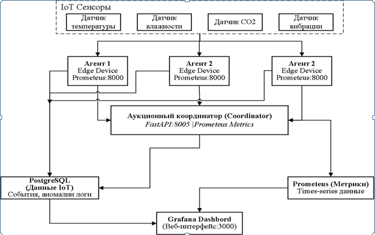
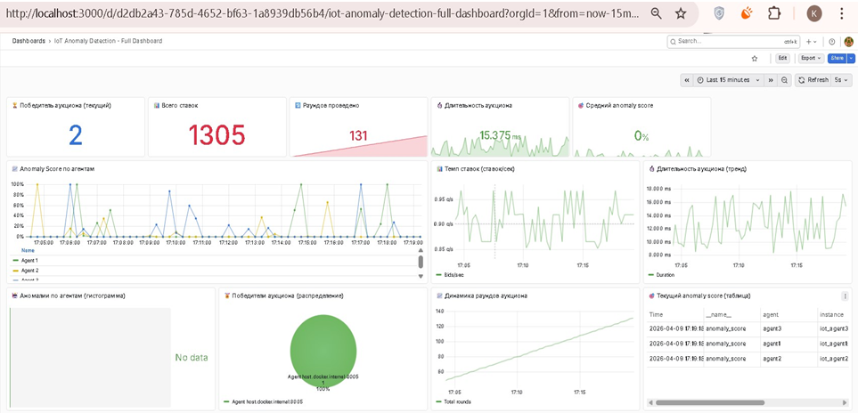

# IoT Real-time Anomaly Detection (Auction-Based)

Инженерный кейс по проектированию распределенной системы обнаружения аномалий в реальном времени для IoT-устройств.

## 🎯 Задача
Разработать децентрализованную систему, которая собирает данные с датчиков (температура, CO2, вибрация), вычисляет аномалии на периферии и координирует действия через аукционный механизм (Leader Election).

## 🏗 Архитектура (Real-time Data Pipeline)
Система построена на микросервисной архитектуре и полностью контейнеризирована (Docker Compose):
1.  **Агенты (IoT Edge):** Собирают данные, вычисляют anomaly score и отправляют ставки координатору.
2.  **Координатор (FastAPI):** Собирает ставки, выбирает победителя (argmax) и сохраняет логи.
3.  **Time-series БД (Prometheus):** Хранит метрики системы в реальном времени.
4.  **Визуализация (Grafana):** Отображает дашборд с динамикой anomaly score и распределением победителей.
5.  **Хранилище истории (PostgreSQL):** Хранит сырые данные и логи аукционов.

## ⚙️ Технологический стек
*   **Python (FastAPI, Psycopg2)** — для логики агентов и координатора.
*   **PostgreSQL** — реляционное хранилище.
*   **Prometheus + Grafana** — мониторинг и визуализация метрик (Data Observability).
*   **Docker + Docker Compose** — контейнеризация и оркестрация (8 сервисов).

## 🚀 Ключевые особенности (Highlights)
*   **Real-time обработка:** Время реакции системы — 4.8 секунды.
*   **Отказоустойчивость:** Выход из строя одного агента не останавливает систему.
*   **Data Observability:** Настроен полноценный мониторинг метрик и алертинг.
*   **Аукционный механизм:** Динамический выбор координатора (Leader Election) на основе наивысшего показателя аномалии.

## 📸 Скриншоты

### Архитектура системы


### Дашборд мониторинга (Grafana)


## 🚀 Запуск проекта
Проект полностью контейнеризирован. Для запуска скопируйте репозиторий и выполните:
```bash
docker-compose up -d
```
Grafana будет доступна по адресу: http://localhost:3000 (admin / admin)

Prometheus: http://localhost:9090

Координатор (API): http://localhost:8001/health

---

**Что делать сейчас:**
1. Создай папки и файлы с кодом (я дал их выше).
2. Загрузи картинки.
3. Обнови README.
